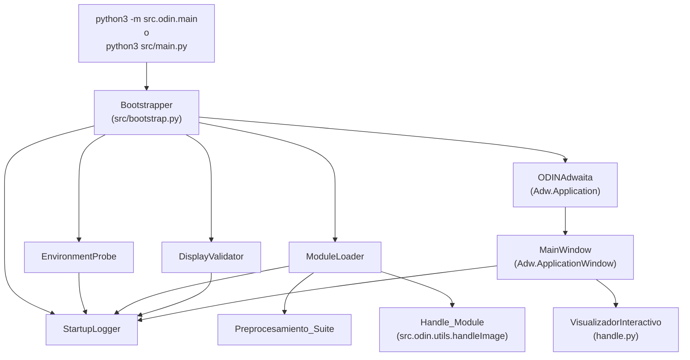
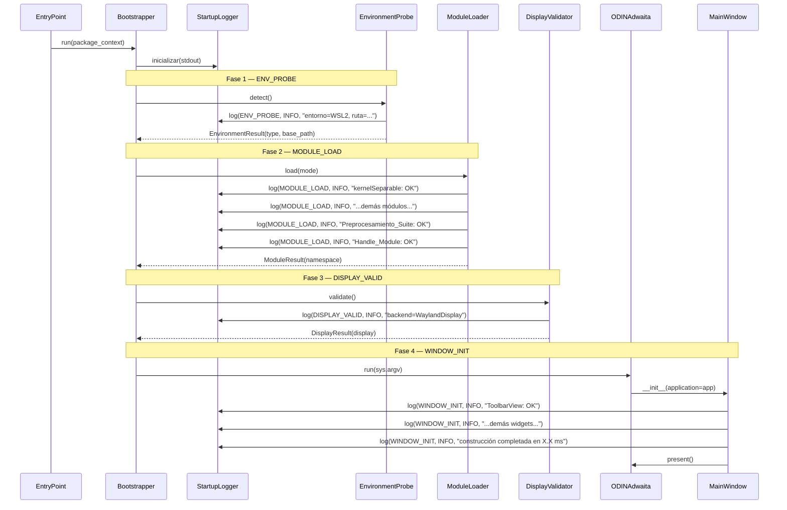
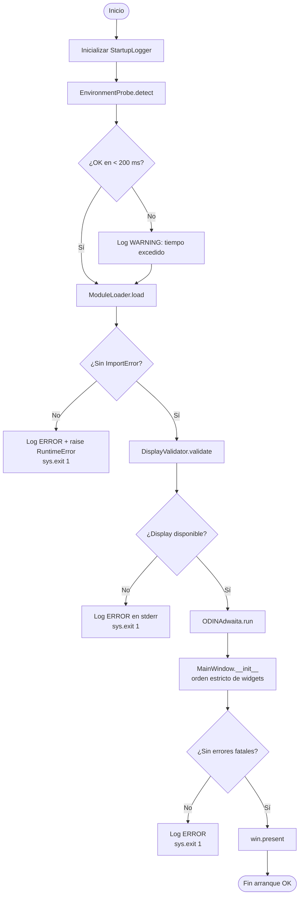

# Design Document: odin-startup-structure

## Overview

Este documento describe el diseño técnico del arranque estructurado de ODIN. El objetivo
es reemplazar el proceso de inicialización implícito actual (importaciones a nivel de módulo
sin manejo de errores, detección de display en el ámbito global, detección de entorno
dispersa en `show_openDialog`) por un flujo explícito y verificable orquestado por un
módulo `Bootstrapper` dedicado.

El resultado es una secuencia de arranque con cuatro fases ordenadas —`ENV_PROBE`,
`MODULE_LOAD`, `DISPLAY_VALID`, `WINDOW_INIT`— registradas en un log diagnóstico
homogéneo con formato `[ODIN] <fase> | <nivel> | <mensaje>`.

### Motivación

El código actual tiene tres problemas estructurales:

1. `Gdk.Display.get_default()` se llama en el ámbito de módulo de `main.py`, lo que
   significa que si no hay display disponible, la excepción ocurre durante la importación,
   sin mensaje claro y sin control sobre el código de salida.
2. La importación de módulos de preprocesamiento en `src/odin/__init__.py` no tiene manejo de
   errores: un `ImportError` en cualquier módulo produce un traceback crudo sin indicar
   cuál módulo falló ni cómo recuperarse.
3. La detección de WSL2/entorno está incrustada en `show_openDialog`, mezclando lógica de
   arranque con lógica de UI.

---

## Architecture

La arquitectura introduce un módulo nuevo `src/bootstrap.py` que contiene las tres clases
de arranque (`DisplayValidator`, `ModuleLoader`, `EnvironmentProbe`) y la clase utilitaria
`StartupLogger`. El módulo `src/main.py` delega en el `Bootstrapper` antes de construir
cualquier widget.



### Flujo de arranque por fases



### Diagrama de flujo de arranque



---

## Components and Interfaces

### 1. `StartupLogger` (`src/bootstrap.py`)

Clase utilitaria que formatea y escribe entradas de log al flujo configurado (por defecto
`sys.stdout`). Encapsula el formato `[ODIN] <fase> | <nivel> | <mensaje>` y maneja el
fallback a `stderr` si `stdout` está cerrado.

```python
FASES = Literal["ENV_PROBE", "MODULE_LOAD", "DISPLAY_VALID", "WINDOW_INIT"]
NIVELES = Literal["INFO", "WARNING", "ERROR"]

class StartupLogger:
    def __init__(self, stream: TextIO = sys.stdout) -> None: ...

    def log(self, fase: FASES, nivel: NIVELES, mensaje: str) -> None:
        """Emite una línea con el formato canónico.
        Si stdout está cerrado, reintenta en stderr y llama sys.exit(1)."""

    def log_phase_complete(self, fase: FASES, duracion_ms: float) -> None:
        """Emite una línea INFO de finalización de fase con duración (1 decimal)."""
```

**Invariantes:**
- Toda línea emitida termina con exactamente un `\n`.
- El codec de salida es siempre UTF-8.
- Los mensajes se truncan a 500 caracteres antes de emitir.

---

### 2. `EnvironmentProbe` (`src/bootstrap.py`)

Detecta el entorno de ejecución y resuelve la ruta base de archivos.

```python
@dataclass
class EnvironmentResult:
    env_type: Literal["WSL2", "DOCKER", "NATIVE_LINUX"]
    base_path: Path

class EnvironmentProbe:
    def __init__(self, logger: StartupLogger) -> None: ...

    def detect(self) -> EnvironmentResult:
        """Ejecuta la detección en < 200 ms.
        Prioridad: DOCKER > WSL2 > NATIVE_LINUX.
        Registra ENV_PROBE INFO al finalizar.
        Si supera 200 ms, registra ENV_PROBE WARNING y continúa."""
```

**Algoritmo de detección:**
1. Verificar existencia de `/.dockerenv` → `DOCKER` (prioridad máxima).
2. Si `os.uname().release` contiene `"microsoft"` (case-insensitive) → `WSL2`.
3. En cualquier otro caso (incluyendo `AttributeError` de `os.uname()`) → `NATIVE_LINUX`.

**Resolución de ruta base:**

| Entorno | Prioridad 1 | Prioridad 2 | Prioridad 3 (garantizado) |
|---------|-------------|-------------|---------------------------|
| WSL2 | `/home/<usuario>/proyectos/ODIN` | `/home/<usuario>` | `Path.home()` |
| NATIVE_LINUX | `/home/<usuario>/proyectos/ODIN` | `/home/<usuario>` | `Path.home()` |
| DOCKER | `/home/<usuario>/proyectos/ODIN` | `/home/<usuario>` | `Path.home()` |

> **Nota de diseño sobre WSL2 y cascada de rutas**: Aunque WSL2 proporciona acceso al sistema de archivos de Windows a través de `/mnt/c/`, el rendimiento de I/O es significativamente mejor cuando se trabaja directamente sobre el sistema de archivos nativo de Linux. Por este motivo, todas las rutas candidatas (incluida la Prioridad 1 del proyecto) están bajo `/home/<usuario>` en lugar del montaje de Windows. La cascada permite arrancar correctamente incluso si el directorio del proyecto no existe, usando el home del usuario como respaldo funcional.

El algoritmo prueba cada ruta en orden usando `.exists()` y `.is_dir()`, deteniéndose en la primera ruta válida. El nombre de usuario se obtiene con `os.getlogin()` o `Path.home().name` como respaldo. La Prioridad 1 apunta al directorio de trabajo preferido del proyecto ODIN; si no existe (p.ej., primera ejecución o instalación limpia), se usa el home del usuario (Prioridad 2), y finalmente `Path.home()` como fallback garantizado.

---

### 3. `ModuleLoader` (`src/bootstrap.py`)

Importa los módulos de `Preprocesamiento_Suite` y `Handle_Module` en orden definido,
con manejo de errores por módulo.

# Orden de carga de Preprocesamiento_Suite
# Formato: (alias_de_importación, nombre_de_archivo_físico)
PREPROCESAMIENTO_SUITE_ORDER = [
    ("kernelSeparable", "DeriGauss"),           # Derivadas Gaussianas
    ("MagnitudGradiente", "MagFase"),           # Magnitud y fase del gradiente
    ("NonMaxSup", "NonMaxSuppressionVectorizado"),  # Non-Maximum Suppression
    ("Otsu", "MtoOtsu"),                        # Umbral de Otsu
    ("DoubleTh", "DThEdgeTrackHyst"),          # Double Threshold + Hysteresis
    ("aproxHough", "houghCircles"),            # Transformada de Hough para círculos
    ("circleFilter", "findCircle"),            # Filtro de círculos
    ("LSC", "circuloSimple"),                  # Least Squares Circle fitting
]

@dataclass
class ModuleResult:
    preprocesamiento: dict[str, ModuleType]
    handle: ModuleType
    mode: Literal["SCRIPT", "PACKAGE"]

class ModuleLoader:
    def __init__(self, logger: StartupLogger, package_context: str | None) -> None: ...

    def load(self) -> ModuleResult:
        """Importa módulos según la estrategia determinada por package_context.
        Para cada (alias, archivo) en PREPROCESAMIENTO_SUITE_ORDER:
          - Importa el archivo (DeriGauss.py, etc.) desde odin.Preprocesamiento
          - Asigna el módulo importado al alias correspondiente (kernelSeparable, etc.)
        Registra MODULE_LOAD INFO por cada módulo exitoso.
        Si un módulo lanza ImportError, registra MODULE_LOAD ERROR y
        relanza RuntimeError con el nombre del módulo en el mensaje.
        Registra 'SCRIPT' o 'PACKAGE' como modo detectado."""
```

**Estrategia de importación:**

| `__package__` | Modo | Estrategia |
|---------------|------|-----------|
| `None` o `""` | `SCRIPT` | Importaciones absolutas desde `sys.path[0]` |
| `"odin"` | `PACKAGE` | Importaciones relativas (`.Preprocesamiento`, `.utils`) |

---

### 4. `DisplayValidator` (`src/bootstrap.py`)

Verifica la disponibilidad del backend gráfico GDK. Se ejecuta **dentro del handler
`on_activate`** para garantizar que GTK ya haya inicializado su subsistema de display.

```python
@dataclass
class DisplayResult:
    display: Gdk.Display
    backend_name: str

class DisplayValidator:
    def __init__(self, logger: StartupLogger) -> None: ...

    def validate(self) -> DisplayResult:
        """Llama Gdk.Display.get_default().
        Si devuelve None:
          - imprime en stderr el mensaje de error estructurado
          - llama sys.exit(1)
        Si tiene éxito:
          - registra DISPLAY_VALID INFO con el nombre del backend
          - devuelve DisplayResult"""
```

**Mensaje de error en stderr (cuando display es None):**
```
[ODIN] DISPLAY_VALID | ERROR | Display_Validator: no se encontró un display GDK disponible.
Acción recomendada: Verifique que DISPLAY o WAYLAND_DISPLAY estén configurados.
```

---

### 5. `Bootstrapper` (`src/bootstrap.py`)

Orquestador de las tres fases de pre-inicialización. Expone una función de nivel de módulo
`run_bootstrap()` que `main.py` llama antes de instanciar `ODINAdwaita`.

```python
@dataclass
class BootstrapResult:
    env: EnvironmentResult
    modules: ModuleResult
    logger: StartupLogger

def run_bootstrap(package_context: str | None = None) -> BootstrapResult:
    """Ejecuta ENV_PROBE → MODULE_LOAD en orden.
    DISPLAY_VALID se ejecuta dentro de on_activate (ver ODINAdwaita).
    Si cualquier fase falla, registra WINDOW_INIT ERROR y llama sys.exit(1).
    Devuelve BootstrapResult para uso en MainWindow."""
```

> **Nota de diseño:** `DisplayValidator.validate()` no puede ejecutarse antes de
> `ODINAdwaita.run()` porque GTK requiere que la aplicación esté corriendo para inicializar
> el subsistema de display. Por este motivo, se invoca al inicio de `on_activate`, antes de
> instanciar `MainWindow`.

---

### 6. Refactor de `src/odin/__init__.py`

El archivo actual importa directamente sin manejo de errores. El refactor lo simplifica a
una re-exportación que depende de que `ModuleLoader` ya haya ejecutado el trabajo real:

```python
# src/odin/__init__.py  — versión refactorizada
"""
Paquete ODIN. Los módulos de preprocesamiento se cargan mediante
ModuleLoader en bootstrap.py durante el arranque; este archivo
solo re-exporta para mantener compatibilidad con imports externos.
"""
__version__ = "1.0.0"
__author__ = "JCelis / ODIN Team"

# Re-exportaciones lazy para compatibilidad (no lanzan la GUI)
from .Preprocesamiento import (
    DeriGauss as kernelSeparable,
    MagFase as MagnitudGradiente,
    NonMaxSuppressionVectorizado as NonMaxSup,
    MtoOtsu as Otsu,
    DThEdgeTrackHyst as DoubleTh,
    houghCircles as aproxHough,
    findCircle as circleFilter,
    circuloSimple as LSC,
)
from .utils import handle

__all__ = [
    "handle", "kernelSeparable", "MagnitudGradiente", "NonMaxSup",
    "Otsu", "DoubleTh", "aproxHough", "circleFilter", "LSC",
]
```

El manejo de `ImportError` queda exclusivamente en `ModuleLoader`. `__init__.py` no imprime
nada por sí mismo.

---

### 7. Exportación pública de bootstrap

El módulo `src/bootstrap.py` contiene componentes que `main.py` y potencialmente otros módulos necesitan importar (`DisplayValidator`, `run_bootstrap`, `BootstrapResult`). Por este motivo, debe ser parte de la interfaz pública del paquete.

**Actualiza `src/odin/__init__.py` para incluir:**

```python
# src/odin/__init__.py  — versión refactorizada con bootstrap público

"""
Paquete ODIN. Los módulos de preprocesamiento se cargan mediante
ModuleLoader en bootstrap.py durante el arranque; este archivo
solo re-exporta para mantener compatibilidad con imports externos.
"""
__version__ = "1.0.0"
__author__ = "JCelis / ODIN Team"

# Re-exportaciones de preprocesamiento (lazy, no lanzan la GUI)
from .Preprocesamiento import (
    DeriGauss as kernelSeparable,
    MagFase as MagnitudGradiente,
    NonMaxSuppressionVectorizado as NonMaxSup,
    MtoOtsu as Otsu,
    DThEdgeTrackHyst as DoubleTh,
    houghCircles as aproxHough,
    findCircle as circleFilter,
    circuloSimple as LSC,
)
from .utils import handle

# Exportación pública de bootstrap (usado por main.py y tests)
from . import bootstrap
from .bootstrap import BootstrapResult

__all__ = [
    "handle", "kernelSeparable", "MagnitudGradiente", "NonMaxSup",
    "Otsu", "DoubleTh", "aproxHough", "circleFilter", "LSC",
    "bootstrap", "BootstrapResult",  # Componentes de arranque
]
```

Esto permite que `main.py` importe con `from odin.bootstrap import run_bootstrap` (modo paquete) o `from bootstrap import run_bootstrap` (modo script).

---

### 8. Refactor de `src/main.py`

Los cambios principales son:

1. **Eliminar** la llamada `Gdk.Display.get_default()` del ámbito de módulo.
2. **Invocar** `run_bootstrap(__package__)` justo antes de `app.run()`.
3. **Mover** `DisplayValidator.validate()` al inicio de `on_activate`.
4. **Eliminar** la lógica de detección WSL2 de `show_openDialog` y reemplazarla por
   `self._bootstrap_result.env.base_path`.

```python
# src/main.py  — estructura refactorizada (pseudocódigo de alto nivel)

# --- imports gi, os, sys, threading, numpy, gtk ---
from .bootstrap import run_bootstrap, DisplayValidator  # o absolutos si SCRIPT

class MainWindow(Adw.ApplicationWindow):
    def __init__(self, *args, bootstrap_result, logger, **kwargs):
        # bootstrap_result lleva env y modules ya resueltos
        # logger para WINDOW_INIT
        # THE `MainWindow` SHALL completar su construcción en menos de 3 segundos en hardware de
        # referencia (CPU de cuatro núcleos a 2.0 GHz o superior, 4 GB de RAM, sin GPU dedicada,
        # ejecutándose en Linux nativo x86_64 o WSL2 con Ubuntu 24.04 o superior)
        t0 = time.monotonic()
        # Orden estricto de construcción:
        # 1. ToolbarView
        # 2. HeaderBar
        # 3. NavigationSplitView
        # 4. Sidebar de controles
        # 5. VisualizadorInteractivo (con fallback a Gtk.Picture)
        # 6. ViewStack de resultados
        ...
        logger.log_phase_complete("WINDOW_INIT", (time.monotonic() - t0) * 1000)
        self.win.present()

    def show_openDialog(self, button, *args):
        # Usa self._base_path (ya resuelto por EnvironmentProbe)
        home_dir = str(self._base_path)
        ...

class ODINAdwaita(Adw.Application):
    def __init__(self, bootstrap_result, logger, **kwargs):
        super().__init__(**kwargs)
        self._bootstrap_result = bootstrap_result
        self._logger = logger
        self.connect("activate", self.on_activate)

    def on_activate(self, app):
        # DISPLAY_VALID ocurre aquí, dentro del ciclo de vida de GTK
        validator = DisplayValidator(self._logger)
        validator.validate()  # sys.exit(1) si falla

        self.win = MainWindow(
            application=app,
            bootstrap_result=self._bootstrap_result,
            logger=self._logger,
        )

if __name__ == "__main__":
    result = run_bootstrap(__package__)
    app = ODINAdwaita(
        bootstrap_result=result,
        logger=result.logger,
        application_id="com.detectorDistancias.Odin",
    )
    sys.exit(app.run(sys.argv))
```

---

## Data Models

### `EnvironmentResult`

```python
@dataclass(frozen=True)
class EnvironmentResult:
    env_type: Literal["WSL2", "DOCKER", "NATIVE_LINUX"]
    base_path: Path          # Siempre una ruta existente y accesible
    detection_ms: float      # Tiempo de detección en milisegundos
```

### `ModuleResult`

```python
@dataclass(frozen=True)
class ModuleResult:
    preprocesamiento: dict[str, ModuleType]  # alias → módulo importado
    handle: ModuleType
    mode: Literal["SCRIPT", "PACKAGE"]
```

### `BootstrapResult`

```python
@dataclass(frozen=True)
class BootstrapResult:
    env: EnvironmentResult
    modules: ModuleResult
    logger: StartupLogger    # Instancia compartida para WINDOW_INIT
```

### Constantes de formato de log

```python
LOG_FORMAT = "[ODIN] {fase} | {nivel} | {mensaje}\n"
MAX_MSG_LEN = 500
MAX_WARN_LEN = 200
FASES = frozenset({"ENV_PROBE", "MODULE_LOAD", "DISPLAY_VALID", "WINDOW_INIT"})
NIVELES = frozenset({"INFO", "WARNING", "ERROR"})
```

---

## Correctness Properties

*Una propiedad es una característica o comportamiento que debe mantenerse verdadero en
todas las ejecuciones válidas de un sistema; en esencia, un enunciado formal sobre lo que
el sistema debe hacer. Las propiedades sirven de puente entre especificaciones legibles por
humanos y garantías de corrección verificables por máquina.*

### Property 1: Formato canónico de toda entrada de log

*Para todo* par válido de `(fase, nivel, mensaje)` donde `fase ∈ FASES`,
`nivel ∈ NIVELES` y `len(mensaje) ≤ 500`, la línea producida por `StartupLogger.log()`
debe tener exactamente la forma `[ODIN] <fase> | <nivel> | <mensaje>\n` y ser
decodificable como UTF-8.

**Validates: Requirements 5.1, 5.5**

---

### Property 2: Duración de fase en formato de un decimal

*Para toda* fase válida y cualquier duración `d ≥ 0.0` ms, el mensaje de completado de
fase producido por `StartupLogger.log_phase_complete()` debe contener el nombre de la fase
y la duración formateada como un número con exactamente un decimal seguido de `" ms"`
(por ejemplo, `"123.4 ms"`).

**Validates: Requirements 5.2**

---

### Property 3: RuntimeError contiene el nombre del módulo fallido

*Para cualquier* módulo de `Preprocesamiento_Suite` cuya importación sea simulada con
`ImportError`, la excepción relanzada por `ModuleLoader.load()` debe ser de tipo
`RuntimeError` y su mensaje debe contener el nombre exacto del módulo fallido como
subcadena.

**Validates: Requirements 2.3**

---

### Property 4: Aborto con log ERROR ante fallo de cualquier componente de arranque

*Para cualquier* componente de los tres (`DisplayValidator`, `ModuleLoader`,
`EnvironmentProbe`) que termine con error, el `Bootstrapper` debe: (a) no haber
instanciado `MainWindow`, (b) haber emitido una entrada de log con nivel `ERROR` que
contenga el nombre del componente fallido, y (c) haber terminado el proceso con
`sys.exit(1)`.

**Validates: Requirements 4.2**

---

### Property 5: ERROR de log contiene componente, tipo de excepción y mensaje

*Para cualquier* par `(componente, excepción)` donde `excepción` es cualquier excepción de
Python, la entrada de log `ERROR` producida por `StartupLogger` debe contener: el nombre
del componente, el tipo de la excepción (nombre de la clase), y el mensaje de la excepción
(truncado a 500 caracteres si es necesario).

**Validates: Requirements 5.4**

---

### Property 6: Clasificación de entorno WSL2 es robusta a capitalización

*Para cualquier* cadena `release` que contenga la subcadena `"microsoft"` en cualquier
combinación de mayúsculas y minúsculas (p.ej. `"Microsoft"`, `"MICROSOFT"`, `"miCRoSoFt"`),
`EnvironmentProbe.detect()` debe clasificar el entorno como `WSL2` (asumiendo que
`/.dockerenv` no existe).

**Validates: Requirements 3.1**

---

### Property 7: DOCKER tiene prioridad sobre WSL2 en cualquier combinación

*Para cualquier* cadena `release` (con o sin `"microsoft"`) y dado que `/.dockerenv`
existe, `EnvironmentProbe.detect()` debe clasificar el entorno como `DOCKER`.

**Validates: Requirements 3.2**

---

### Property 8: base_path siempre apunta a una ruta existente

*Para cualquier* entorno detectado (`WSL2`, `NATIVE_LINUX` o `DOCKER`) y cualquier nombre
de usuario, `EnvironmentProbe.detect()` debe devolver un `base_path` tal que
`base_path.exists()` sea `True` (usando la ruta candidata principal si existe, o
`Path.home()` como fallback garantizado).

**Validates: Requirements 3.3, 3.4**

---

### Property 9: Log de Environment_Probe contiene entorno y ruta base

*Para cualquier* `EnvironmentResult` producido por `EnvironmentProbe.detect()`, la entrada
de log `ENV_PROBE INFO` debe contener el valor de `env_type` como cadena y la ruta absoluta
de `base_path` como cadena.

**Validates: Requirements 3.5**

---

### Property 10: Mensaje de error de Bootstrapper contiene módulo y modo

*Para cualquier* combinación de `(módulo, modo)` donde `módulo` es el nombre de un módulo
que no pudo resolverse y `modo ∈ {"SCRIPT", "PACKAGE"}`, el mensaje de error terminal debe
contener el nombre del módulo y la cadena del modo como subcadenas.

**Validates: Requirements 6.3**

---

### Property 11: Log de MODULE_LOAD contiene modo y nombres de módulos resueltos

*Para cualquier* modo de ejecución (`SCRIPT` o `PACKAGE`) y cualquier lista de módulos
resueltos exitosamente, la entrada de log `MODULE_LOAD INFO` de estrategia debe contener
el modo como cadena y cada nombre de módulo resuelto como subcadena.

**Validates: Requirements 6.5**

---

## Error Handling

### Errores de importación de módulos

`ModuleLoader` envuelve cada `import` en un `try/except ImportError`. Ante un fallo:
1. Se registra `MODULE_LOAD | ERROR | <nombre_módulo>: ImportError: <mensaje>`.
2. Se relanza como `RuntimeError(f"Módulo '{nombre}' no pudo cargarse: {e}")`.
3. El `Bootstrapper` captura el `RuntimeError`, registra `WINDOW_INIT | ERROR` y llama
   `sys.exit(1)`.

No se intenta continuar la carga de módulos posteriores al módulo fallido: la suite entera
es una dependencia atómica.

### Display no disponible

Si `Gdk.Display.get_default()` devuelve `None`:
1. Se escribe en `stderr` el mensaje de error estructurado (fuera del logger normal, porque
   el logger escribe a `stdout` que podría estar disponible en contenedor sin display).
2. Se llama `sys.exit(1)` sin construir ningún widget GTK.

### Timeout de EnvironmentProbe

`EnvironmentProbe` mide su propio tiempo de ejecución. Si supera 200 ms, emite
`ENV_PROBE | WARNING` y continúa; no es un error fatal.

### Fallo de VisualizadorInteractivo

Si `handle.VisualizadorInteractivo()` lanza cualquier excepción en `MainWindow.__init__`:
- Se construye un `Gtk.Picture` de respaldo con las mismas propiedades de expansión.
- Se emite `WINDOW_INIT | WARNING | VisualizadorInteractivo falló, usando Gtk.Picture como respaldo: <causa>`.
- La construcción de widgets continúa normalmente.

### stdout cerrado

Si `StartupLogger.log()` encuentra que `stdout` está cerrado o lanza `OSError`:
1. Reintenta escribir en `sys.stderr`.
2. Llama `sys.exit(1)` inmediatamente.

---

## Testing Strategy

### Herramienta de testing

Se usa **pytest** con **Hypothesis** como biblioteca de property-based testing. Hypothesis
está disponible como dependencia de desarrollo (`pip install hypothesis`).

### Pruebas unitarias (basadas en ejemplos)

Las pruebas de ejemplo cubren comportamientos específicos no aptos para PBT:

- `DisplayValidator`: mock de `Gdk.Display.get_default()` → `None` → verificar stderr +
  `sys.exit(1)`; mock con objeto → verificar log `DISPLAY_VALID INFO`.
- `ModuleLoader` modo SCRIPT vs PACKAGE: verificar que la estrategia se selecciona solo
  por `__package__`.
- `MainWindow`: verificar orden de construcción de widgets con mocks de Gtk.
- `EnvironmentProbe` timing: verificar que si la detección supera 200 ms se emite WARNING.
- `StartupLogger` fallback: simular `stdout` cerrado → verificar escritura en stderr.

### Pruebas de propiedad (Hypothesis)

Cada prueba de propiedad se configura con al menos 100 iteraciones. Se etiquetan con el
formato `Feature: odin-startup-structure, Property N: <texto>`.

**Property 1 — Formato canónico de log:**

```python
# Feature: odin-startup-structure, Property 1: formato canónico de toda entrada de log
@given(
    fase=st.sampled_from(list(FASES)),
    nivel=st.sampled_from(list(NIVELES)),
    mensaje=st.text(max_size=500),
)
@settings(max_examples=200)
def test_log_format_canonical(fase, nivel, mensaje):
    buf = io.StringIO()
    logger = StartupLogger(stream=buf)
    logger.log(fase, nivel, mensaje)
    line = buf.getvalue()
    assert line.startswith(f"[ODIN] {fase} | {nivel} | ")
    assert line.endswith("\n")
    assert line.count("\n") == 1
    line.encode("utf-8")  # no lanza → decodificable
```

**Property 2 — Duración con un decimal:**

```python
# Feature: odin-startup-structure, Property 2: duración de fase en formato de un decimal
@given(
    fase=st.sampled_from(list(FASES)),
    duracion=st.floats(min_value=0.0, max_value=60_000.0, allow_nan=False),
)
@settings(max_examples=200)
def test_log_phase_complete_duration_format(fase, duracion):
    buf = io.StringIO()
    logger = StartupLogger(stream=buf)
    logger.log_phase_complete(fase, duracion)
    line = buf.getvalue()
    # Debe contener la fase y un patrón de duración con 1 decimal
    assert fase in line
    assert re.search(r"\d+\.\d ms", line) or re.search(r"\d+\.\d+ ms", line)
    # Exactamente 1 decimal
    match = re.search(r"([\d]+\.[\d]+) ms", line)
    assert match and len(match.group(1).split(".")[1]) == 1
```

**Property 3 — RuntimeError contiene nombre del módulo:**

```python
# Feature: odin-startup-structure, Property 3: RuntimeError contiene el nombre del módulo fallido
@given(nombre_alias=st.sampled_from([alias for alias, _ in PREPROCESAMIENTO_SUITE_ORDER]))
@settings(max_examples=50)
def test_module_loader_runtime_error_contains_name(nombre_alias, monkeypatch):
    # simula ImportError para el módulo dado (usando el alias de importación)
    ...
    with pytest.raises(RuntimeError) as exc_info:
        loader.load()
    assert nombre_alias in str(exc_info.value)
```

**Property 6 — WSL2 robusto a capitalización:**

```python
# Feature: odin-startup-structure, Property 6: clasificación WSL2 robusta a capitalización
@given(
    prefix=st.text(alphabet=st.characters(blacklist_categories=("Cs",)), max_size=20),
    suffix=st.text(alphabet=st.characters(blacklist_categories=("Cs",)), max_size=20),
    variant=st.sampled_from(["microsoft", "Microsoft", "MICROSOFT", "miCRoSoFt"]),
)
@settings(max_examples=200)
def test_wsl2_detection_case_insensitive(prefix, suffix, variant, tmp_path):
    release = f"{prefix}{variant}{suffix}"
    probe = EnvironmentProbe(logger=..., dockerenv_path=tmp_path / "nonexistent")
    result = probe._classify(release)
    assert result == "WSL2"
```

**Property 7 — DOCKER tiene prioridad:**

```python
# Feature: odin-startup-structure, Property 7: DOCKER tiene prioridad sobre WSL2
@given(release=st.text(max_size=50))
@settings(max_examples=200)
def test_docker_priority_over_wsl2(release, tmp_path):
    dockerenv = tmp_path / ".dockerenv"
    dockerenv.touch()
    probe = EnvironmentProbe(logger=..., dockerenv_path=dockerenv)
    result = probe._classify(release)
    assert result == "DOCKER"
```

**Property 8 — base_path siempre existe:**

```python
# Feature: odin-startup-structure, Property 8: base_path siempre apunta a ruta existente
@given(
    env_type=st.sampled_from(["WSL2", "NATIVE_LINUX", "DOCKER"]),
    user=st.text(min_size=1, max_size=20, alphabet=st.characters(whitelist_categories=("Ll",))),
)
@settings(max_examples=100)
def test_base_path_always_exists(env_type, user):
    result = EnvironmentProbe._resolve_base_path(env_type, user)
    assert result.exists()
```

### Pruebas de integración

- Ejecutar `python3 -m odin.main --version` en un entorno sin display y verificar que el
  proceso termina con código 1 y un mensaje legible en stderr.
- Ejecutar `python3 src/main.py --version` (modo SCRIPT) y verificar que los módulos se
  resuelven correctamente.
- Verificar que el log completo de arranque contiene exactamente una entrada por módulo de
  `Preprocesamiento_Suite` en el orden definido.
